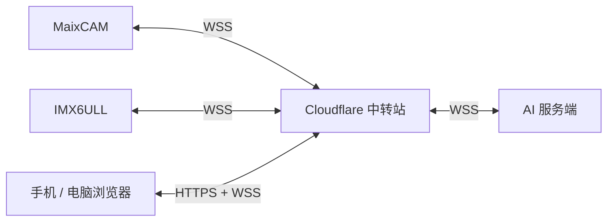

# MX6ULL与中转

本项目面向嵌入式设备的智能值守场景，通过云端中转站连接 IMX6ULL、MaixCAM 和 AI 服务端，实现设备状态监测、自然语言交互与远程控制，并逐步扩展视觉分析和远程运维能力。

中转站基于 **Cloudflare Worker 和 Durable Objects** 构建，统一提供监控网页与 WebSocket 通信接口。开发板和 AI 服务端主动建立连接，由中转站转发传感器数据、控制指令及执行结果，减少对设备公网 IP 和端口映射的依赖。手机和电脑可通过浏览器接入，多个客户端能够同时查看设备状态并进行远程操作，控制结果以板端实际执行回执为准。

目前已完成中转站搭建、网页监控、温度与光照读取、LED 远程控制，以及 AI 交互和上位机联调。后续将重点完善摄像头与 AI 的协同分析，并推进远程日志读取、Linux 交叉编译及板端部署更新。

需要便于阅读或打印的简版说明，可查看 [Word 使用说明](使用说明.docx)，内附中转站架构图。

## 能做什么

| 功能 | 使用方式与范围 |
| --- | --- |
| 设备监测 | 查看 IMX6ULL 的芯片温度、AP3216C 光照和 LED 状态；芯片温度不是室内环境温度。 |
| 远程控灯 | 通过 MaixCAM 语音或手机网页开灯、关灯；操作结果由板端实际回读确认。板端界面也支持本地控制。 |
| 语音和文字问答 | 在 MaixCAM 上按住录音或输入文字，AI 服务端返回回答，语音回答由相机播放。 |
| 图片提问 | 提供单张图片提问入口，默认关闭；需要时按 [相机说明](camera/README.md) 启用，并在目标设备上验证。 |
| 网页监控 | 手机和电脑浏览器均可访问，显示设备状态、本次页面的温度曲线，并控制 LED。支持多个浏览器客户端同时连接。 |
| 天气查询 | 语音询问天气，未指定城市时默认北京；查询需要联网。 |
| 日程记录 | 语音添加、查询日程，保存到 AI 服务端的 `data/schedules.md`，并同步到网页显示。时间采用北京时间，目前不自动提醒。 |
| 板端界面与上位机 | 提供原生 Qt 板端界面及配套监控工具，具体编译、设备适配与运行方式见 [板端说明](imx6ull/smart-monitor/README.md)。 |

远程日志与故障诊断、交叉编译、自动部署更新，以及基于视觉的智能调控，仍属于后续开发范围。

## 系统怎么连接



- **MaixCAM**：负责语音采集、交互和语音播放，可选图片提问。USB 视频需要单独配置。
- **IMX6ULL**：采集传感器数据、执行 LED 控制，并显示板端界面。
- **中转站**：使用 Cloudflare Worker 提供监控网页和通信入口，结合 Durable Objects 管理 WebSocket 长连接，转发设备状态、控制请求和执行回执。各端主动连接中转站，减少对设备公网 IP 和端口映射的依赖。
- **AI 服务端**：运行本项目的电脑助手，负责语音识别、问答和语音合成。可根据运行环境部署到电脑或 Linux 主机，需要持续在线。

网页使用设备口令接入，多个客户端共享同一设备状态。当前不包含独立用户账户和细粒度权限管理，也不提供持续视频流的网页转发。

## MaixCAM Pro 的系统与联网

MaixCAM Pro 运行嵌入式 Linux，MaixPy 提供摄像头、录音、播放等 Python 接口，设备可通过 MaixVision 终端或 SSH 管理程序与文件。安装网络工具前，应先确认固件及 CPU 架构，详见 [官方 Linux 说明](https://wiki.sipeed.com/maixpy/doc/zh/basic/linux_basic.html)。

需要代理联网时，本项目在相机上运行 sing-box，由聊天程序通过 `127.0.0.1:7890` 的 HTTP CONNECT 代理访问中转站，再完成 TLS / WebSocket 握手。它是显式应用代理，不等于全机 TUN VPN。

配置、启动、节点选择和排错步骤见 [MaixCAM Linux 与 VPN／代理接入](camera/LINUX_NETWORK.md)。其中只提供工具和示例，节点密码与账户由使用者自行配置。

## 准备

需要 MaixCAM、IMX6ULL、Cloudflare 账号，以及具备 Node.js 24、Python 3.12 和可用 Codex 环境的电脑或 Linux 主机。设备需要能够联网。以下命令都在本项目目录执行。

## 1. 准备依赖

```sh
npm install
python -m venv .venv
```

Windows：

```powershell
.venv\Scripts\python -m pip install -r requirements.txt
.venv\Scripts\python voice\setup_models.py
```

Linux 使用 `.venv/bin/python` 执行上面两条命令。语音模型只需下载一次。

## 2. 配置连接

```sh
npm run configure
```

打开生成的 `config.local.json`，填写：

- `relayUrl`：自己的中转地址，例如 `wss://imx-ai-relay.你的子域.workers.dev/ws`。
- `voiceModel`：自己账号可用的模型。

设备口令 `deviceToken` 和 AI 端口令 `bridgeToken` 会分别自动生成。相机、开发板和网页使用设备口令；`bridgeToken` 只供 AI 服务端与中转站使用。

自定义中转名称时，同时修改 `workerName`。程序找不到 Codex 或 Python 时，填写 `codexBinary` 或 `pythonBinary` 的完整路径；确实需要代理时，再配置 `cameraUseProxy`、`cameraProxyHost`、`cameraProxyPort` 或 `boardProxy`。

填好后，再运行一次 `npm run configure`。

## 3. 部署和连接设备

```sh
npx wrangler login
npm run deploy
```

- **MaixCAM**：将 `camera/maixcam_voice.py` 和 `.local/camera/config.local.json` 放到相机同一目录，在 MaixVision 中运行脚本。相机需先连接 Wi-Fi。
- **IMX6ULL**：按照 [板端说明](imx6ull/smart-monitor/README.md) 编译、运行。使用生成的 `.local/board/relay.conf`，并将启动环境中的 `CLOUD_RELAY_HOST` 设为自己的中转域名。

板端原生程序需要适配自己的 Qt/ARM SDK、屏幕、摄像头和传感器节点。这里的板端编译由使用者在自己的开发环境完成，不是系统自动执行的远程交叉编译功能。

## 4. 开始使用

```sh
npm start
```

电脑助手启动后需要保持运行，关闭运行窗口或停止进程会使 AI 交互和日程同步离线。

打开 `https://你的中转域名/mini`，输入 `config.local.json` 中的 `deviceToken`，即可查看传感器数据、控制 LED 和查看日程。电脑端助手暂时离线时，只要开发板与中转站仍在线，网页的传感器监测和 LED 控制仍可使用。

可以对 MaixCAM 说：

- “开灯”“关灯”。
- “现在温度多少”“现在光照多少”。
- “天气怎么样”——默认查询北京。
- “添加日程，明天下午三点开会”。
- “查看我的日程”。

添加日程时一次说清日期、时间和事项；听到“已保存日程”后，可到网页查看。网页当前只显示日程，添加操作使用语音入口。

## 常见问题

| 现象 | 先检查什么 |
| --- | --- |
| 提示 `cloud offline` | AI 服务端是否仍在运行 `npm start`，以及是否成功连接中转站。 |
| 网页没有温度或光照 | 开发板是否在线、口令是否一致、板端传感器与驱动是否正常。 |
| 控灯没有成功确认 | 检查板端 LED 接口和回读；网页发送成功不代表硬件已经执行。 |
| 日程没有保存 | 使用完整句式，如“添加日程，明天下午三点开会”；确认日期和时间没有歧义。 |

口令、账户与网络参数均由使用者自行配置。不要分享 `config.local.json`、`.local/` 等私人配置或个人日程数据。

依赖详情见 [DEPENDENCIES.md](DEPENDENCIES.md)。
